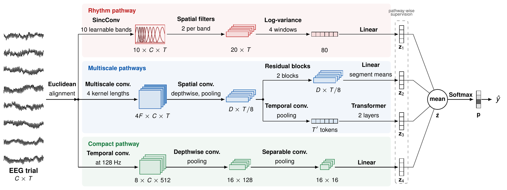

# CrossRhythm

Code, trained models and results for the paper

> D. Urgun, "CrossRhythm: Spectro-Temporal Decoding of Motor Imagery EEG Across Sessions."

CrossRhythm decodes motor imagery from EEG recorded on a later day than the
data it was calibrated on. It combines an explicit, learnable **rhythm pathway**
(sinc band-pass filters and band-power features) with three temporal pathways
(residual, transformer and compact EEGNet pathways) in a single network.



## Contents

| Path | Content |
|---|---|
| `crossrhythm/` | Python package: model, preprocessing, data loading, training, static and causal evaluation, data preparation |
| `scripts/` | Command-line scripts (see below) |
| `splits/` | Fixed assignment of every trial to training, validation and test data |
| `checkpoints/` | Trained CrossRhythm models, one per participant (22 in total) |
| `results/` | Per-trial predictions of all trained models and the result tables |
| `configs/` | Download links and checksums of the datasets |
| `licenses/` | License texts of third-party code (see `THIRD_PARTY_NOTICES.md`) |

## Installation

Python 3.9 is required. From the repository folder:

```bash
python -m venv .venv
source .venv/bin/activate          # Windows: .venv\Scripts\activate
pip install -r requirements.txt
```

For training on a GPU, install the CUDA build of PyTorch 2.7.1 that matches
your driver (see https://pytorch.org). Evaluation also runs on a CPU.

## Usage

### 1. Reproduce the result tables (no EEG data needed)

```bash
python scripts/reproduce_tables.py
```

The tables of the paper (accuracy, statistical comparison, per-participant
accuracy and ablation) are recomputed from `results/predictions.csv.gz` and
written to `results/tables/`.

### 2. Download and prepare the datasets

```bash
python scripts/prepare_data.py --download --prepare
```

This downloads BCI Competition IV 2a and 2b and Zhou2016 (about 1.6 GB) into
`data/raw/` and writes the 4-s trials to `data/prepared/` (about 0.6 GB). Every
prepared array is checked against a reference checksum.

### 3. Evaluate the trained models

```bash
python scripts/evaluate.py --dataset zhou2016 --subject 1
python scripts/evaluate.py --dataset bciciv2a --subject all
```

Each model is evaluated on the later sessions of its participant in the static
and the causal setting. The script prints the accuracy per participant and
checks that the predictions agree with the stored predictions.

### 4. Train new models

```bash
python scripts/train.py --dataset zhou2016 --subject 1 --seed 17
python scripts/train.py --dataset bciciv2a --subject all --seed 17 --no-rhythm-pathway
python scripts/evaluate.py --dataset zhou2016 --subject 1 --checkpoint runs/zhou2016_s01_seed17.pt
```

The paper uses the seeds 17, 42 and 2026 to 2033. One model takes about 40 min
on a single GPU. `--no-rhythm-pathway` trains the ablation variant.

## Evaluation protocol

* **Data.** For each participant, the earlier sessions are used for training
  (80%) and validation (20%), and the later sessions for testing.
* **Training.** A model is pretrained on the earlier sessions of all other
  participants of the same dataset (source data) and then calibrated on the
  earlier sessions of the target participant.
* **Static setting.** The alignment and normalization statistics from the
  calibration data stay fixed during testing.
* **Causal setting.** The test trials are processed in recording order; each
  trial is classified first and then used, without its label, to update the
  alignment and batch-normalization statistics.

## Results

Accuracy (%) on the later sessions, mean over 22 participants and ten seeds:

| Decoder | Causal | Static |
|---|---:|---:|
| EEGNet | 74.9 | 74.7 |
| GAT | 76.6 | 75.4 |
| EEG-SimpleConv | 73.3 | 77.7 |
| MSVTNet | 77.8 | 77.9 |
| DMSACNN | 79.0 | 78.5 |
| **CrossRhythm** | **86.4** | **82.9** |

All tables, including the per-dataset results and statistical tests, are
produced by `scripts/reproduce_tables.py`.

## Trained models

`checkpoints/` contains one CrossRhythm model per participant, trained with
seed 2029, one of the ten seeds of the paper. Their pooled accuracy (86.8%
causal, 83.4% static) is close to the ten-seed means reported in the paper.
The accuracy of every model is listed in `results/released_models.csv`.
Models for the other seeds can be trained with `scripts/train.py`.

## Competing decoders

The predictions of the five competing decoders, each retrained with the
training procedure of its original implementation, are included in
`results/predictions.csv.gz`. The original implementations are:

| Decoder | Reference | Original code |
|---|---|---|
| EEGNet | Lawhern et al., J. Neural Eng., 2018 | [vlawhern/arl-eegmodels](https://github.com/vlawhern/arl-eegmodels) |
| GAT | Song et al., IEEE TNSRE, 2023 | [eeyhsong/Adaptor](https://github.com/eeyhsong/Adaptor) |
| EEG-SimpleConv | El Ouahidi et al., IEEE TNSRE, 2024 | [elouayas/EEGSimpleConv](https://github.com/elouayas/EEGSimpleConv) |
| MSVTNet | Liu et al., IEEE JBHI, 2024 | [SheepTAO/dpeeg](https://github.com/SheepTAO/dpeeg) |
| DMSACNN | Liu et al., IEEE JBHI, 2025 | [xingxin-99/DMSANet](https://github.com/xingxin-99/DMSANet) |

## Datasets

* BCI Competition IV 2a: C. Brunner et al., "BCI Competition 2008 – Graz data set A," Graz University of Technology, 2008.
* BCI Competition IV 2b: R. Leeb et al., "BCI Competition 2008 – Graz data set B," Graz University of Technology, 2008.
* Zhou2016: B. Zhou et al., "A fully automated trial selection method for optimization of motor imagery based brain-computer interface," PLoS ONE, vol. 11, no. 9, e0162657, 2016.

## Citation

If you use this code, please cite the paper above (see also `CITATION.cff`).

## License

MIT License (see `LICENSE`). Third-party components keep their own licenses
(see `THIRD_PARTY_NOTICES.md`).
